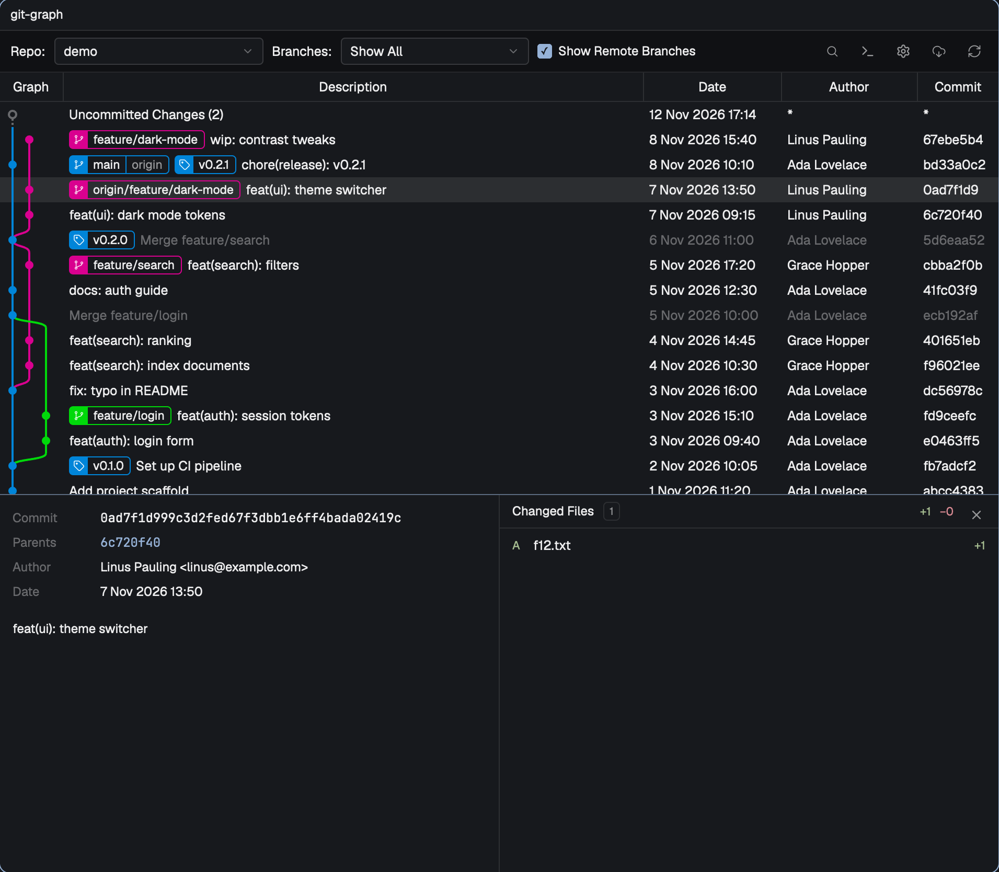

# Git Graph for Herdr

A [Herdr](https://herdr.dev) mod that shows a repository's commit graph the way the
[Git Graph](https://github.com/mhutchie/vscode-git-graph) extension does in VS Code: coloured
branch lanes, ref badges, commit details with changed files and diffs, branch filter, find,
fetch, repository settings and the full context menus (checkout, merge, rebase, cherry-pick,
revert, reset, push, stashes…).



## Install

Copy `mods/git-graph/` into `~/.config/herdr-app/mods/`, then check it:

```sh
herdr-app check ~/.config/herdr-app/mods/git-graph
```

Open it as a tab:

```sh
herdr-app do tab.new '{"mod":"git-graph","name":"Git Graph","props":{"tab":true}}'
```

or pin it to a repo with `"props":{"folder":"/path/to/repo"}`. Key commands for `keys.json`
(`"<key>": "git-graph:<command>"`): `down`, `up`, `toggle`, `compare`, `menu`, `find`, `fetch`,
`refresh`, `repos`, `settings`, `close`.

## Notes

- It runs `git` (reads never write under `.git`), and `pbcopy` for Copy (macOS only).
- It picks the repo from the last focused terminal of the space if a tab bar mod records it in
  `shared("git-graph.focus")` (`{ [spaceId]: { cwd, on } }`), else from the space's terminals.
- How to rebuild it from scratch: [RECIPE.md](RECIPE.md).

## License

MIT
