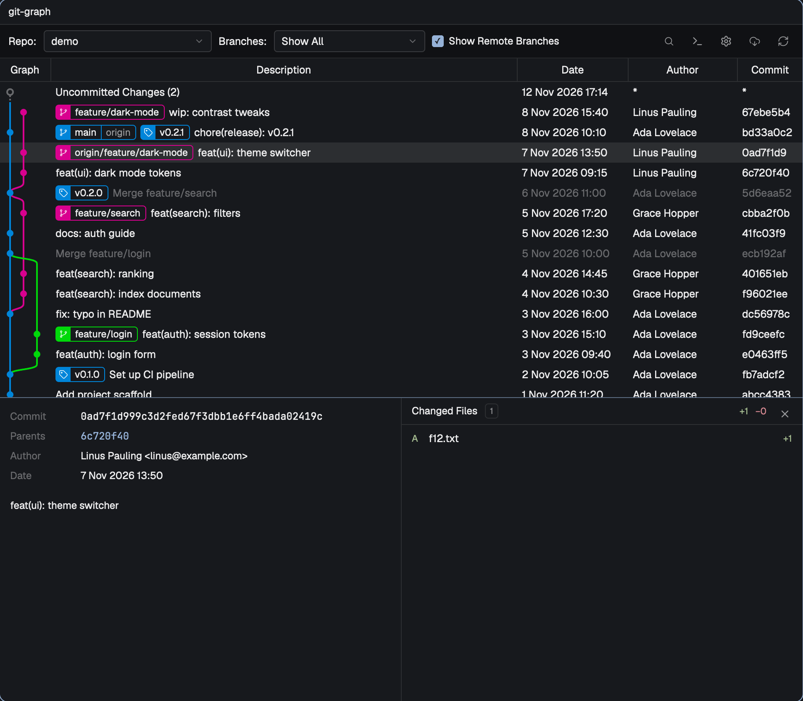

# Git Graph

A commit graph for Herdr that looks and works like the Git Graph extension for VS Code
(mhutchie): coloured branch lanes with curved merges, ref badges, Date / Author / Commit
columns, a commit details panel with changed files and diffs, a branch filter, find, fetch,
repository settings and the full Git Graph context menus (checkout, merge, rebase,
cherry-pick, revert, reset, push, stashes…). It opens as a tab, so it gets the whole work
area.

## What you see

Top to bottom, in one mod pane:

- **Toolbar** (40px, `chrome` background, bottom border): bold `Repo:` with a 200px dropdown
  (the repository and its initialized submodules, with a "Filter Repos..." field), bold
  `Branches:` with a dropdown ("Show All", or the picked branches; multi-select, local then
  remote), a `Show Remote Branches` checkbox (accent fill when on), then on the right 26px icon
  buttons: Find, Open a Terminal, Repository Settings (gear), Fetch, Refresh. Labels hide as the
  pane narrows (Branches < 460px, the checkbox < 560px).
- **Find bar** (36px, when Find is on): input, "N of M", ↑ / ↓, close.
- **Header** (28px): bold, centred column titles `Graph | Description | Date | Author | Commit`,
  separated by 1px `border` lines. Date shows ≥ 640px wide, Author ≥ 800px, Commit ≥ 500px.
- **Rows** (24px each, virtual list):
  - Graph cell: 16px per lane, 2px strokes, 4px-radius dots. Lane colours are Git Graph's
    palette `#0085d9 #d9008f #00d90a #d98500 #a300d9 #ff0000 #00d9cc #e138e8 #85d900 #dc5b23
    #6f24d6 #ffcc00`; a new branch takes the first colour no live lane uses. Lines into a
    commit from another lane and merge lines out of it are cubic curves. The column is at most
    22% of the pane wide.
  - The top row "Uncommitted Changes (N)" (bold) when the working tree is dirty: a hollow grey
    dot, a dashed grey line down to HEAD, Date = now, Author and Commit = `*`.
  - Stash rows (Show Stashes) sit just above the commit they were made on: hollow dot in the
    lane colour and a grey `stash@{n}` badge.
  - Description: badges, then the subject. A local branch badge: 18px high, 1px border and a
    filled icon cell in the lane colour, the name (bold for the checked-out branch); a remote on
    the same commit joins it as an italic muted `origin` segment. Remote-only branches and tags
    (tag icon) use the lane colour too. Detached HEAD shows a `HEAD` badge.
  - Merge commits are drawn in `dim` in every column. Date as `12 Nov 2026 16:40`, Commit as the
    first 8 hex digits.
  - The selected row has `selected`, hover `hover`; find matches tint with the accent.
  - "Load More Commits" at the end when more than 300 (then +300 per click).
- **Details panel**, docked at the bottom (45% of the height, 220–560px) for the clicked commit:
  left Commit / Parents (click to jump) / Author / Committer (if different) / Date and the full
  message; right "Changed Files" with count and +/− totals, each file with its A/M/D/R/U status
  colour, name, folder, +adds −dels. Clicking a file shows its diff (old/new line numbers,
  green/red rows, hunk headers on `raised`); ≥ 900px wide the file list stays beside the diff.
  For Uncommitted Changes the left side has a "Commit message" input and "Commit all".

## How it behaves

- Click a row: open / close its details. Cmd/Ctrl-click a second row: compare the two
  (older → newer, or → working tree). Right-click a row: its context menu.
- Keys while focused: ↑ / ↓ select, Enter opens, Cmd/Ctrl-F find (Enter = next), Esc closes the
  find bar, the diff, then the details.
- Context menus (popups) list the commit's branches and tags first ("Branch dev ›" opens that
  ref's menu), then:
  - commit: Add Tag…, Create Branch…, Checkout…, Cherry Pick…, Revert…, Drop…, Merge into current
    branch…, Rebase current branch on this Commit…, Reset current branch to this Commit…
    (soft / mixed / hard), Copy Commit Hash / Subject;
  - local branch: Checkout, Rename…, Delete… (force, also on remotes), Merge…, Rebase…, Push…
    (remote, set upstream, normal / force with lease / force), Copy Name;
  - remote branch: Checkout… (local tracking branch), Delete Remote Branch…, Fetch into local
    branch…, Merge…, Pull into current branch…, Copy Name;
  - tag: Delete Tag… (also on remote), Push Tag…, Copy Name;
  - stash: Apply…, Pop… (reinstate index), Drop…, Create Branch from Stash…, Copy Name / Hash;
  - uncommitted: Stash…, Reset uncommitted changes… (mixed / hard), Clean untracked files…,
    Open terminal here.
  Items ending in "…" open a dialog with Git Graph's options; destructive ones have a red
  confirm button. Errors from git show in the dialog.
- Repository Settings (dialog): General (Name shown in Repo, Show Stashes, Show Tags, Include
  commits only mentioned by reflogs, Only follow the first parent), User Details
  (`user.name` / `user.email` in the repo's config: Edit, Remove), Remote Configuration (fetch,
  edit name / fetch / push URL, delete with confirmation, Add Remote).
- It refreshes on a folder watch of the repo (debounced 1.2s; local machines), every 10s, and
  after any action. Remote spaces run git on their machine.
- Which repo: `props.folder` if given; else the last focused terminal of the space
  (`shared("git-graph.focus")[spaceId].cwd`, if a tab bar mod records it), else the focused
  pane's folder, else every terminal folder of the space (the shown tab's first) until one is a
  repo. The Repo dropdown's pick wins for its superproject.

## Built from

- One mod folder, `mods/git-graph/`, in four roles chosen by props: the graph (no props,
  `{tab: true}` for a tab that follows its space, or `{folder, on}` pinned to a repo), a popup
  menu (`props.menu`: commit / head / remote / tag / stash / uncommitted / branches / repos),
  an action dialog (`props.dialog`), and Repository Settings (`props.settings`).
- `main.js` (view, details, menus, dialogs), `graph.js` (lane layout + `PathBuilder` /
  `window.paint_path` drawing), `git.js` (reads with `--no-optional-locks -c
  core.fsmonitor=false -c diff.autoRefreshIndex=false` so the folder watch doesn't loop),
  `actions.js` (menus and dialog definitions → git argv), `settings.js`.
- `herdr`: `exec`, `readTextFile`, `watchFolder`, `spaces`, `panes`, `focused`, `theme`,
  `settings`, `props`, `run` (`tab.new`, `terminal.open`), `openOverlay` / `closeOverlay`,
  `shared` / `setShared` (`git-graph.cfg` per-repo options, `git-graph.repo` picks,
  `git-graph.rev` refresh signal), `notify`, `nextCommand`.
- Programs: `git`; `sh` + `pbcopy` for Copy (macOS).
- Its own icons (lucide-style SVGs) and `spinner.svg`.

## Watch out

- Rows of a `v_virtual_list` can't take their own click handlers (they throw): use the list's
  `on_item_click` / `on_item_secondary_click`, and keep interactive parts (the details panel,
  inputs) outside the list. That is why details dock at the bottom and badges have no own menu.
- A popup sizes to its content: a `flex_1` child gets no height there. In a panel,
  `overflow_y_scrollbar()` wraps its element, so give a scrolling list an absolute layer in a
  `relative` parent instead.
- `PathBuilder` is chained: reassign (`b = b.line_to(...)`). Coordinates are local to the
  `paint_path` element; size it `.absolute().top(0).left(0).size_full()`.
- The `herdr` export `window` shadows gpui's: use `globalThis.window.paint_path`.
- `InputState.new` only in `init` or handlers, never in `render`.
- A mod pane reports its space's folder, not a repo, so don't trust `focused().cwd` there.
- `exec` has no stdin: Copy pipes through `sh -c 'printf %s "$1" | pbcopy'`.
- Not done: Issue Linking and Pull Request Creation from Git Graph's settings; resizable columns.

## Done when

- `herdr-app check mods/git-graph` passes.
- `herdr-app do tab.new '{"mod":"git-graph","name":"Git Graph","props":{"tab":true}}'` in a
  space with a repo shows its graph; `git log --graph --oneline` has the same topology, and
  branch, remote and tag badges sit on the same commits.
- Clicking a commit shows its files; clicking a file shows its diff.
- Right-click → Create Branch… creates the branch and the graph shows it without a manual
  refresh; Reset… Hard moves the branch.
- Show Remote Branches, Show Tags and the Branches filter change the graph.
- The Repo dropdown lists submodules and switching shows the submodule's graph.
